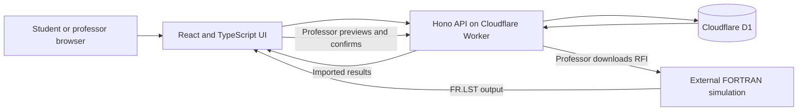

# SampleSlice — Restaurant Simulation Management Platform

**LSU ISDS 4125 capstone** · Kylie LaCaze, Sarah Reid, Kalynn Loftis, Tahj Foster, and Cole Jacobs

SampleSlice is a full-stack application for managing an educational restaurant business simulation. Students make operational, menu, and financial decisions for their assigned restaurants. A professor exports those decisions as RFI input files, runs the legacy FORTRAN simulation separately, and imports its FR.LST output. Students can then examine their restaurant's results and compare teams on a leaderboard.

**The FORTRAN program is external. SampleSlice does not run it or calculate simulation outcomes.** It generates files in the application's approved format and imports supported output; acceptance by a particular FORTRAN executable has not been established.

- [Architecture and design](#architecture-and-design)
- [Application workflows](#application-workflows)
- [Public Demo Mode](#public-demo-mode)
- [Cloudflare environments](#cloudflare-environments)
- [Local development](#local-development)
- [API and data model](#api-and-data-model)
- [Repository structure](#repository-structure)
- [Testing and quality assurance](#testing-and-quality-assurance)
- [Limitations and future work](#limitations-and-future-work)
- [Collaboration and AI guidelines](#collaboration-and-ai-guidelines)

## Architecture and design



The public demo follows a separate path: it uses bundled, parsed Q1–Q5 results and browser-session drafts, without retrieving or writing authenticated data.

| Layer | Implementation and reason | Trade-off |
| --- | --- | --- |
| Frontend | React 18, TypeScript, React Router, Vite, and Tailwind CSS 4 provide reusable components and typed decision and result models for the team's student and professor pages. | Shared components need careful testing so a change for one workflow does not disrupt another. |
| API and hosting | Hono runs in a Cloudflare Worker; Workers Static Assets serves the built frontend from the same application. A small API layer separates presentation from authorization, validation, and file processing. | Workers have a constrained runtime; local and hosted behavior must both be checked. |
| Storage | Cloudflare D1 provides SQLite-backed relational storage, migrations, foreign keys, and parameterized queries through a Worker binding. | Schema changes and data migrations require coordination; local D1 and each hosted database are separate. |
| Development and testing | Project-local Wrangler runs and deploys the Worker. Vitest, Testing Library, and Miniflare support component, logic, and local Worker/D1 tests. | Automated tests do not replace browser, device, or external simulator testing. |

### Roles and data relationships

Accounts have a student or professor role. The Worker validates sessions and roles, and student queries scope private decisions and results to the assigned team; frontend navigation is not the security boundary. Professors can see team submission statuses, export submitted decisions, import results, and use the comparative leaderboard. Accounts are provisioned by an operator rather than public registration; the current UI does not provide general participant or team administration.

The six original tables are `User`, `Team`, `TeamDecision`, `MenuItem`, `MenuItemDecision`, and `TeamMetrics`. A student belongs to a team; a team's assigned firm number maps it to a simulation firm. Decisions and aggregate results are keyed by team and round. Ordered menu decisions belong to a team and round; the same item and preparation cannot be entered twice in one round. Later migrations add authentication, import provenance, and menu-result tables. There is no separate quarter table: round numbers identify periods in the decision and result records. This design keeps competing firms and historical rounds separate, but changes to mappings or legacy file formats require careful validation.

Passwords use salted scrypt hashes. Server-managed sessions store token hashes in D1, expire after eight hours, and are revoked on logout. Cookies are HTTP-only and SameSite=Lax; HTTPS cookies are Secure and use the `__Host-` prefix. Login errors are generic, requests are rate limited, and POST requests have an origin check. These controls do not replace review of deployment security and account provisioning before broader use.

### Decisions, files, and results

The app keeps decision entry separate from the existing simulator so it can support the established exercise without reimplementing undocumented simulation mathematics. Students can save incomplete drafts, then review and submit complete Q2–Q7 decisions. Submission locks the round. Validation is shared by the Worker and browser preview: field-specific maxima, allowed signs, decimal precision, catalog/preparation choices, and duplicate selections are checked. Staff, prices, quantities, and budgets cannot be negative; the three whole-dollar finance changes can be signed. Required fields and at least one menu selection are enforced at submission; public demo drafts require completeness when saved. This protects the fixed-width export while still allowing authenticated students to save unfinished work.

The professor downloads one `RFI{firm}ME.TXT` for each submitted, mapped team. The generator uses fixed-width ASCII records with CRLF endings and the approved eight-field Finance layout: three signed whole-dollar changes followed by five fixed unsigned zeros. Values that do not fit are rejected rather than rounded or truncated. Product report must be **No** because its enabled export mapping is unconfirmed. See the [RFI specification](docs/rfi-specification.md) for the exact supported profile and its limitations.

After an external simulation run, the professor selects Q1–Q7 and uploads an ASCII `.LST` file. The parser validates the selected period, five firm statements, roster, and supported menu values. The preview shows the firm-to-team mappings, metrics, menu rows, and warnings. Confirmation checks the file and preview token and stores the mapped results in a D1 batch. Replacing a different import for an existing round requires explicit confirmation; an identical file is a no-op. Unsupported or invalid files are rejected. Only supported printed fields are stored; see the [FR.LST specification](docs/fr-lst-specification.md).

The student dashboard and both role-specific leaderboards read the same imported team metrics. Rankings use net income, operating profit, or **revenue calculated as stored food sales plus beverage sales**; that sum can differ slightly from a printed total because the listing rounds lines independently. A leaderboard is available only when an import maps all five firms and all five results exist. Users can select a quarter and metric, and the interface retains selections when navigating. No ranking calculation runs the simulation.

Responsive layouts, semantic labels, keyboard focus styles, a skip link, status/error messages, and mobile-friendly demo controls make the workflows accessible across screen sizes. Real-device and assistive-technology testing remain useful follow-up work.

## Application workflows

### Student

1. Sign in with an operator-provisioned account and see the assigned team.
2. Open **Decisions**, select Q2–Q7, and edit menu, staffing, operations, finance, and report choices. Complete menu rows can autosave; **Save Draft** is also available.
3. Select **Review & Submit**, review the saved values, and submit. A submitted round is locked.
4. Open **Results** for imported Q1–Q7 metrics, menu performance, and trends. A round without an import shows an empty state.
5. Open **Leaderboard** to compare the five firms by net income, revenue, or operating profit for released quarters.

### Professor

1. Sign in and review team submission statuses, including a team-filtered status view. The current team review is not a full decision-detail editor.
2. Open **RFI Generation**, select Q2–Q7, and download files for submitted teams with assigned firm numbers.
3. Run FORTRAN separately, then open **FR.LST Import**. Select Q1–Q7, choose the matching listing, preview the firms and warnings, and confirm the import or an explicitly approved replacement.
4. Open **Leaderboard** to compare released results. An authenticated student sees the imported dashboard for their own team. Import confirmation makes results available; there is no separate publish button.
5. A dedicated presentation environment can expose **Reset Presentation** to an authenticated professor when its protected reset snapshot is installed; the normal Worker does not register that endpoint.

## Public Demo Mode

Open [Try Demo Mode](https://restaurant-simulation-app-staging.sampleslice.workers.dev/demo), or choose **Try Demo Mode** on the staging sign-in page. No account is required. The route opens directly to a student Results Dashboard for **Team 1: Demo Bistro**; professor controls are not available.

The demo offers Q1–Q5 results, five-team leaderboards, and editable Q5 decisions. Its figures are bundled from parsed historical Q1–Q5 listings; original private files are not included. Decisions are saved in the visitor's browser session, and validation uses the application's existing rules with additional checks for complete, correctly formatted demo drafts. The floating toolbar shows the team and quarter and provides **Reset Demo** and **Exit Demo**. Quarter and leaderboard selections persist within the browser session.

**Demo edits never submit decisions, generate RFI files, write to D1, run FORTRAN, or recalculate results and rankings.** Reset clears the browser's demo draft and selections. The demo uses a separate frontend provider and does not need authenticated API calls. Its mobile layout is designed for a QR-code audience; physical-device testing is still recommended.

## Cloudflare environments

| Environment | Purpose | Configuration |
| --- | --- | --- |
| [Regular staging](https://restaurant-simulation-app-staging.sampleslice.workers.dev/) | Authenticated staging application and public audience demo. | `wrangler.staging.jsonc`, Worker `restaurant-simulation-app-staging`, separate staging D1 binding. |
| [Presentation](https://sampleslice-presentation.sampleslice.workers.dev/) | Separate authenticated professor-led Q1-to-Q2 demonstration. | `wrangler.presentation-hosted.jsonc` is a checked-in template for Worker `sampleslice-presentation` and a separate D1 database. Its committed database ID is a placeholder and must not be deployed as-is. |

The presentation setup starts with Q1 results for five firms, Q2 decisions for five firms, an editable Team 1 Q2 draft, and no Q2 results. A student edits and submits Q2 decisions; the professor exports RFI files, describes the separate FORTRAN run, and imports a historical Q2 FR.LST file. The student can then view Q2 results and the leaderboard. The historical file is from an earlier run and **does not reflect the live edits**.

When installed in the dedicated presentation database, Reset Presentation requires a professor session, explicit confirmation, a matching host/origin, and a snapshot marker. It restores the snapshot's Q1 results and Q2 decisions, makes Team 1's original decision editable, and removes imported Q2 results while preserving accounts, password hashes, and sessions. It is unavailable from the regular staging Worker. Never reset or reseed an existing database as a routine deployment step.

The tracked hosted configuration and [hosted presentation notes](docs/hosted-presentation.md) retain an older hostname and setup instructions; an authorized operator must verify the actual host, database ID, snapshot, and remote bindings before making changes. The local presentation setup is documented separately in [Q1-to-Q2 presentation](docs/presentation-q1-q2.md). Do not deploy, change passwords, or modify either shared environment without authorization.

## Local development

### Install and initialize

Use Node.js 20 or later and npm. The repository includes Wrangler as a development dependency. Clone, install the lockfile, initialize **local** D1, and build the asset directory:

```bash
git clone https://github.com/cole7jacobs/restaurant-simulation-app-trial-run.git
cd restaurant-simulation-app-trial-run
npm ci
npm run db:init
npm run build
```

`db:init` applies the five migrations and loads repeatable fictional development fixtures, including five teams. These seed results are not FORTRAN output and contain no account credentials. Local D1 state is under ignored `.wrangler/`; the ID in `wrangler.jsonc` is a local placeholder. No Cloudflare credentials are needed for local development. To run the steps individually:

```bash
npm run db:migrate
npm run db:seed
```

Start two terminals:

```bash
npm run dev:api  # local Worker on http://localhost:8787
```

```bash
npm run dev      # Vite, normally http://localhost:5173
```

Open `http://localhost:5173`; Vite proxies `/api` to the Worker. Use the same hostname consistently for session cookies and POST origin checks. `npm run preview` builds and serves the frontend and API together through the local Worker. The public demo can be explored at `http://localhost:5173/demo` without database initialization or login when the Vite frontend is running.

Check the local Worker and D1 without changing records:

```bash
curl -f http://localhost:8787/api/health
curl -f http://localhost:8787/api/health/db
npx wrangler d1 execute DB --local --command "SELECT TeamID, TeamName, FirmNumber FROM Team ORDER BY FirmNumber"
npx wrangler d1 execute DB --local --command "PRAGMA foreign_key_check"
```

An empty foreign-key check means no violations were found. `db/schema.sql` is a historical reference; the versioned migrations are the current schema source of truth.

### Local accounts and sign-in

After `npm run db:init`, create accounts in a trusted Bash or Zsh terminal. Enter different passwords of 15–256 characters at the hidden prompts; do not place them in Git or command arguments. The seeded Demo Bistro is team `-1` in the ordinary local database.

```bash
printf 'Student password: '; read -rs account_password; printf '\n'
printf '%s\n' "$account_password" | npm run account:create -- student student@example.invalid 'Local Student' -1
unset account_password

printf 'Professor password: '; read -rs account_password; printf '\n'
printf '%s\n' "$account_password" | npm run account:create -- professor professor@example.invalid 'Local Professor'
unset account_password
```

Sign in at `http://localhost:5173/login`. Accounts are created once; students must be assigned an existing team. `LOCAL_D1_STATE` selects a different local persistence directory for the account script, and Wrangler commands must use the matching `--persist-to`. The `--staging` and `--presentation` account options write to hosted databases and are for explicitly authorized operators only. The development-only `/dev` preview is not authentication and cannot authorize API calls.

## API and data model

All paths are relative to the application origin. Student and professor routes require a valid session and role; student private data is scoped to their team. See Worker code for payloads and error cases.

| Endpoint | Purpose |
| --- | --- |
| `GET /api/health`, `GET /api/health/db` | Worker liveness and database schema/integrity readiness |
| `POST /api/auth/login`, `POST /api/auth/logout`, `GET /api/auth/session` | Sign-in, sign-out, session state |
| `GET /api/student/team/:teamId?` | Assigned team; other teams are forbidden |
| `GET` / `POST /api/student/decisions/:round` | Read and save or submit student decisions |
| `GET /api/student/results/:round` | Assigned team's imported results |
| `GET /api/student/leaderboard/:round`, `GET /api/professor/leaderboard/:round` | Released five-firm rankings data |
| `GET /api/professor/submissions` | Team and round submission statuses |
| `GET /api/professor/rfi/:round`, `GET /api/professor/rfi/:round/:teamId` | Export roster and individual RFI download |
| `POST /api/professor/import/:round/preview`, `POST /api/professor/import/:round/confirm` | Validate, preview, and import an FR.LST file |
| `GET /api/professor/presentation/status`, `POST /api/professor/presentation/reset` | Dedicated presentation entry points only; protected reset status and confirmation |

The five migrations define the six core tables above plus `AuthSession`, `LoginRateLimit`, `SimulationResultImport`, and `MenuItemResult`. Dedicated presentation snapshot tables are installed separately for reset; they are not part of the normal application migrations. `MenuItemResult` may link to a matching decision slot, but baseline or unmatched results remain available. See `db/migrations/` for constraints and indexes.

## Repository structure

```text
src/
  App.tsx                 Route tree and role layouts
  components/ui/          Shared controls and visual components
  context/                Authentication and development-preview state
  routes/student/         Student decisions and results
  routes/professor/       Professor pages, RFI and import interfaces
  routes/shared/          Shared leaderboard
  lib/                    Demo fixtures, browser drafts, and design helpers
  data/demo-results.json  Parsed public demonstration results
  styles/                 Shared styles
a\n```

The remaining principal paths are:

```text
worker/                   Hono API, auth, decision handling, RFI, FR.LST, reset
shared/                   Shared decision validation, catalog, and result types
db/migrations/            Versioned D1 schema changes
db/seed.dev.sql           Fictional development data
test/                     Component, Worker, D1, format, and fixture tests
scripts/                  Account provisioning and presentation preparation
docs/                     File specifications and environment procedures
.github/workflows/        Pull-request CI
wrangler*.jsonc           Local, staging, and presentation Worker configurations
```

The ignored `input-output/` archive holds private original reference files. Keep its structure and contents unchanged; do not commit or deploy it. Compact fixtures and parsed public demo data are separate from the originals.

## Testing and quality assurance

Before opening a pull request:

```bash
npm run type-check
npm run test:run
npm run build
```

`npm test` runs Vitest in watch mode. Tests cover React components, decision validation and submission, role and team isolation, migrations and D1 relationships, RFI formatting, FR.LST parsing/import, leaderboard availability and consistency, and browser-only demo behavior. Worker integration tests use isolated Miniflare D1 state and local loopback networking rather than the developer's database. Some comparisons against private historical files are skipped if the archive is absent; committed fixtures and synthetic tests still run. CI runs the same three checks on pull requests to `main`. These tests are not comprehensive end-to-end or physical-device coverage.

## Limitations and future work

- FORTRAN execution and the transfer of files to and from it remain external and manual. RFI compatibility with a particular executable is unverified.
- The importer supports the known five-firm layout and catalog labels, not every possible listing variant or printed field. Raw examples cover Q1–Q5 and Q7; an equivalent raw Q6 listing was not available. Menu prices and portions are not stored as result metrics.
- The approved RFI profile uses market `ME`, fixed archived constants, eight Finance fields, and Product report **No**. Some legacy field meanings remain undocumented. Do not silently change the profile or invent simulation rules.
- The professor team review shows submission status rather than full decision details; account and team management remain operator-driven. There is no public registration or self-service password reset.
- Demo changes are temporary and never produce new results. Additional browser/device, accessibility, error-handling, and deployment-readiness work would improve confidence.

## Collaboration and AI guidelines

Work on a feature branch based on current `main`, open a pull request, run checks, request review, and update the branch in response to feedback. Keep different features isolated so teammates can work in parallel and resolve conflicts deliberately. Once an approved PR is merged, update local `main` before starting another branch. Cloudflare deployments are separate, explicitly authorized operations. See [CONTRIBUTING.md](CONTRIBUTING.md).

```bash
git switch main
git pull --ff-only
git switch -c <your-feature-branch>
# Make focused changes and run the checks above.
git add <intended-files>
git commit -m "Describe the change"
git push -u origin <your-feature-branch>
```

For teammates and AI coding assistants:

1. Inspect the relevant implementation, migrations, tests, and specifications before editing; this README is a map, not a substitute for the code.
2. Preserve working behavior and reuse existing components, APIs, architecture, and schema. Avoid unrelated changes.
3. Do not invent FORTRAN rules or change validated RFI/FR.LST formats without agreed requirements and reference-based tests.
4. Never commit secrets, passwords, tokens, local databases, generated private SQL, or original private simulation files.
5. Do not change shared Cloudflare staging or presentation resources without authorization.
6. Add meaningful tests for behavior changes and run the type check, automated suite, and build; report failures or skips.
